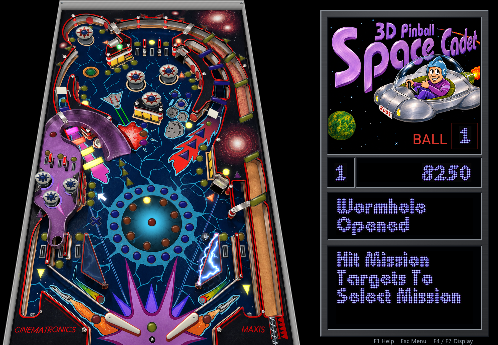
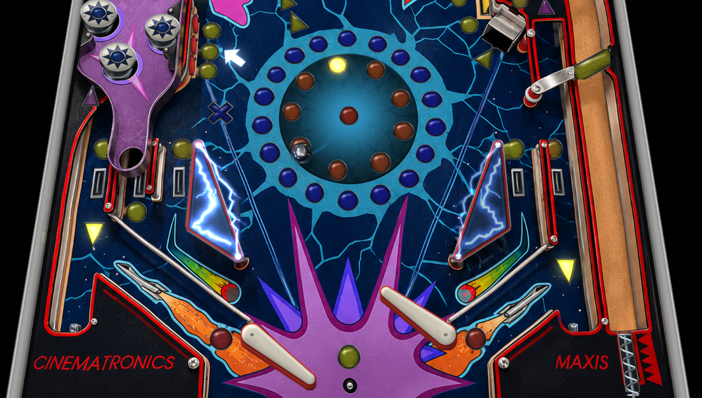
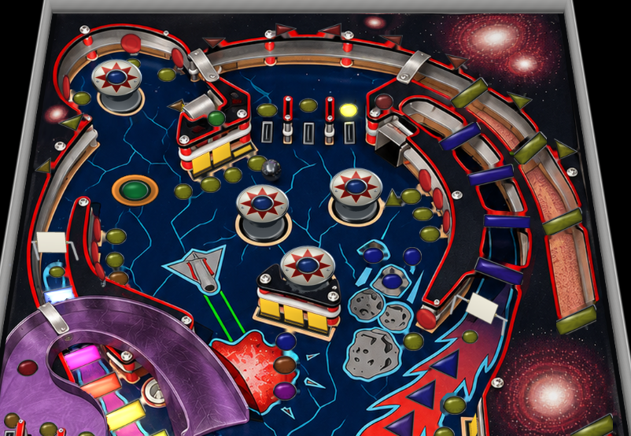
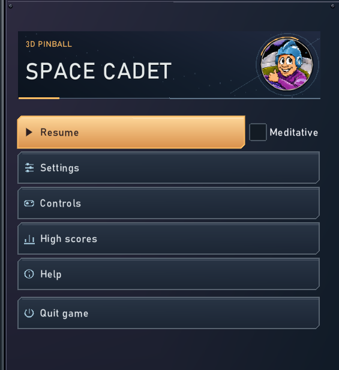
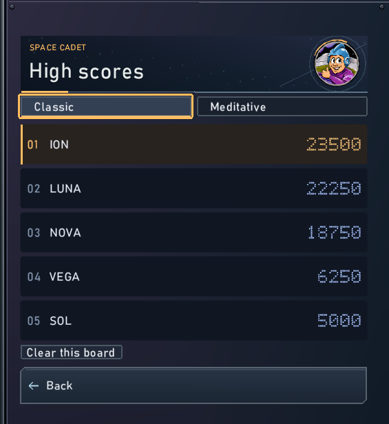

# Space Cadet HD Remastered

**A Windows remaster of 3D Pinball: Space Cadet.** The mission targets still drop with the same clack, the arrows still lead you to the launch ramp, and an ill-timed flip can still cost you the ball. The difference is easiest to see in motion. Send the ball past a lit bumper and watch its colour travel across the polished steel.



The artwork may feel unfamiliar on the first launch, especially if you know the Windows table by heart. Give it a ball or two. The old routes, sounds and lamp cues are good landmarks while your eye adjusts to the new materials.

The screenshots on this page were captured in SDR from version **7.0.2**. On an HDR display, the lamps and dot-matrix displays have additional brightness headroom.

## The table

- **Original rules and scoring.** The Windows table data drives the layout, collision geometry, switches and mechanisms. Complete missions, advance through the ranks, light the return lanes and shoot the wormholes. Classic and Meditative each keep their own top five.
- **Four-times-resolution artwork.** The HD set combines AI-assisted enlargement with redrawn and aligned artwork. The artwork and its masks follow the original mechanisms as they move. Spinner blades rotate about their axles, the plunger spring compresses between its original poses, and raised rails pass in front of the lamps below. HD graphics and subtle edge smoothing each have a switch in Settings.
- **Light with a source.** On compatible Windows displays, Direct3D 11 outputs linear scRGB HDR. Lit inserts, the dot-matrix displays and electrical flashes can rise above the brightness of the printed playfield. The steel ball traces reflection rays against relief reconstructed from the original depth data. Nearby lights and metal guides contribute to what you see as it rolls. The game also runs in SDR.
- **More precise rebounds.** The solver locates the first contact in each step and uses the outgoing speed for the remaining time. A second contact can happen in the same step. Left and right flipper strokes receive the same angular precision. Friction at the table, rails and flippers gives the ball its own angular velocity. Side spin can change the direction of a glancing rebound, and the polish turns with the ball.



### Watch between shots

The galaxies turn independently, carrying their red star belts. The green planet turns slowly on the backglass. Current travels down the blue veins in the playfield and through the softly breathing central disc. The two stars behind the flippers light in turn while you wait to launch. Hit a slingshot to see its faint electrical pattern break into a flash. On the backglass, look for a glint crossing the title or a brief flare from the rocket exhaust.



### Meditative mode

Open **Esc**, tick **Meditative**, then select **Play** to start a new game. Both outlane kickbacks rearm, fuel stays full, and nudges are gentler and rate-limited with no tilt penalty. A well-timed stroke at the tip of a flipper can reach an otherwise unreachable centre shot. Leave the flippers down or press too late and the ball can still drain. Switch between the two high-score tables with the mouse or the controller shoulders.

## Sound and music

All 60 original WAV effects are preserved. The mixer has **32 simultaneous effect voices**, up from eight, so a flipper, a bumper and a long mission cue can finish together even when the table gets busy. A stereo-linked peak limiter protects loud combinations while keeping individual hits at their recorded level.

For music, the original score pairs synth bass, vibraphone, muted guitar and drums. **GeneralUser GS** plays that arrangement as a seamlessly looped stereo recording, keeping the note velocities, pitch bends and effects sends. **Original MIDI** plays the score through the available MIDI synthesizer. To compare them, open **Esc → Settings**, enable **Music** and change **Instrument bank**. New profiles start with table sounds on at **128/128**, music off, and GeneralUser GS selected at **64/128** for when you turn it on. [GeneralUser GS by S. Christian Collins](https://github.com/mrbumpy409/GeneralUser-GS)

## At the cabinet

An English or Russian in-game menu opens with **Esc**. The dot-matrix score and mission displays support both languages, including Cyrillic. **F1** brings up a short guide at the table. Choose a proportional window size, cycle the presets or fill the display. Maximizing the window enters fullscreen. Switching away pauses the game. When a ball is in play, an optional countdown and a brief cue around the ball help you find it again.

| In-game menu | High scores |
| --- | --- |
|  |  |

### Default controls

| Action | Keyboard or mouse | Controller |
| --- | --- | --- |
| Flip left / right | Left / right **Shift**, or left / right mouse button | **LB / RB** on Xbox, **L1 / R1** on PlayStation |
| Pull and release the plunger | Hold and release **Space** or the middle mouse button | Hold and release **A / Cross**, or pull the **right stick** down and let it return |
| Nudge left / right / up | **X / . / ↑**, or the side mouse buttons for left and right | **D-pad** or **left stick** in that direction |
| Open the menu or go back | **Esc** | **Menu / Options** |
| Open in-game help | **F1** | Choose **Help** in the menu |
| Start a new game | **F2**, or **Space** after game over | Can be bound in Controls |
| Pause or resume | **F3**, or **Space** to resume a manual pause with the menu closed | Can be bound in Controls |
| Toggle fullscreen / cycle window sizes | **F4 / F7**. Double-clicking the backglass also toggles fullscreen. | Can be bound in Controls |
| Toggle table sounds / music | **F5 / F6** | Can be bound in Controls |
| Rebind controls | **F8** or **Esc → Controls** | Choose **Controls** in the menu |

Xbox controllers, PlayStation DualShock 4 and DualSense, and standard controllers exposed by Steam Input use SDL's game-controller mappings. Select an action and press the physical key, mouse button, trigger or controller button you want. Left and right modifiers have separate bindings. The analog plunger remembers the deepest pull before release. Analog nudging and analog launching can be switched independently.

## Run or build on Windows x64

Windows x64 is the verified platform for 7.0.2. Linux and macOS builds are experimental and untested. You may encounter build errors or differences in fullscreen behaviour, input and audio. The HDR output currently requires Windows.

The repository contains the engine, remastered artwork masters and build recipes. Supply the original Windows game data from your own installation. The original executable, WAV effects, MIDI score and game DAT are distributed separately from this source tree.

1. Install Visual Studio 2022 with the Desktop development with C++ workload, the Windows SDK and CMake.
2. Extract the Visual C++ development ZIPs for [SDL 2.32.10](https://github.com/libsdl-org/SDL/releases/tag/release-2.32.10) and [SDL_mixer 2.8.1](https://github.com/libsdl-org/SDL_mixer/releases/tag/release-2.8.1) into `deps`. The build script expects `deps/SDL2-2.32.10` and `deps/SDL2_mixer-2.8.1`.
3. Run the following in PowerShell from the source root. Replace the example path with the folder containing your own `PINBALL.DAT`.

```powershell
.\BuildForWindows.ps1
$original = 'D:\Games\Pinball'
$data = New-Item -ItemType Directory -Force .\bin\Release\Data
Get-ChildItem -LiteralPath $original -File | Where-Object Extension -In '.DAT','.MID','.WAV' | Copy-Item -Destination $data.FullName
```

**HD artwork.** If you have the 7.0.2 build, copy its `HD` folder beside the executable. To generate it yourself, follow the Python setup and weights download in [the artwork build notes](BUILD-HD.md), then run the command below in that Python environment. It builds the texture set from the original Windows DAT, the included art masters and the Real-ESRGAN weights.

```powershell
python tools/art-v2/bake.py bin/Release/Data/PINBALL.DAT bin/Release/HD --weights realesr-general-x4v3.pth
```

**Music.** The original MIDI uses the score in `Data`. For GeneralUser GS, copy your existing `Music` folder beside the executable or render the loop locally from your MIDI with 64-bit Python, GeneralUser GS 2.0.3 and the FluidSynth 2.6.2 Windows libraries. The [music notes](tools/BONUS-MUSIC.md) identify the exact bank and synthesizer downloads.

```powershell
python tools/render_bonus_music.py --midi bin/Release/Data/PINBALL.MID --sf2 'D:\MusicTools\GeneralUser-GS.sf2' --bin 'D:\MusicTools\fluidsynth\bin' --out bin/Release/Music/SpaceCadet-GS.ogg
.\bin\Release\SpaceCadetHD.exe
```

Scores, bindings and settings are stored in `%APPDATA%\SpaceCadetHD\imgui_pb.ini`. For implementation details, see the [physics notes](PHYSICS-HD7.md) and [mixer measurements](AUDIO-HD7.md).

## Roadmap

Future platform work includes:

- Bring the SDR remaster to Linux and macOS and verify window and fullscreen behaviour, controller input and audio on each platform.
- Explore a PortMaster release for Linux-based retro handhelds, with particular attention to playfield readability and rendering performance on small screens.

## Where it comes from

The engine license covers its source code. Original game assets, title artwork and third-party projects retain their respective notices. The Real-ESRGAN license is included in `tools/Real-ESRGAN-LICENSE.txt`. Screenshots show the remaster running with the original game data.

Space Cadet HD Remastered is a fork of k4zmu2a's **SpaceCadetPinball**, the reverse-engineered engine for *3D Pinball for Windows – Space Cadet*. Its reconstruction makes it possible to keep the original table logic and build the remaster around it. The source snapshot is `cb9b7b886244a27773f66b0b19fdc2998392565e`. For the engine's history, credits and MIT terms, see the [upstream project notes](docs/upstream-project.md), [license](LICENSE) and [original repository](https://github.com/k4zmu2a/SpaceCadetPinball).
